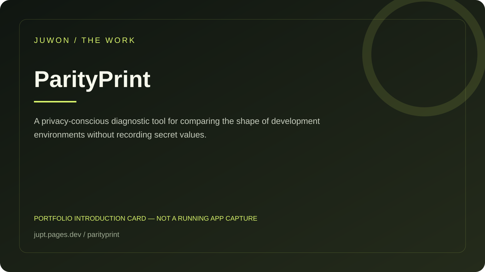

<!-- JUWON-PORTFOLIO-INTRO:START -->
# ParityPrint



*Portfolio introduction card, not a screenshot of a running application.*

*포트폴리오 소개 카드입니다. 실행 화면 캡처가 아닙니다.*

## English

A privacy-conscious diagnostic tool for comparing the shape of development environments without recording secret values.

[View JUWON's portfolio](https://jupt.pages.dev/) · [Browse the project collection](https://jupt.pages.dev/projects)

**Scope:** This README presents the repository's documented intent and recorded visual evidence. It does not certify that every feature is complete, deployed, or currently working. Follow the original setup, safety, and license documentation below.

## 한국어

비밀값을 기록하지 않고 개발 환경의 형태를 비교하는 진단 도구.

[JUWON 포트폴리오 보기](https://jupt.pages.dev/) · [전체 프로젝트 보기](https://jupt.pages.dev/projects)

**확인 범위:** 저장소의 문서상 목적과 기록된 화면 근거를 소개합니다. 모든 기능의 완성·배포·현재 정상 작동을 보증하지 않습니다. 설치법·안전 주의사항·라이선스는 아래 기존 문서를 확인하세요.
<!-- JUWON-PORTFOLIO-INTRO:END -->

---

## Original documentation / 기존 문서

# ParityPrint 🧾

**Prove why it works on your machine — without leaking what is on it.**

ParityPrint captures the *shape* of a development environment, then checks it
on another machine or in CI. It records only whether selected environment keys
are `set`, `empty`, or `missing`, plus coarse Python and OS identity. Secret
values never enter the snapshot.

```text
machine A                         machine B / CI
parityprint snapshot parity.json  parityprint check parity.json
        │                                  │
        └────── reviewable parity report ──┘
```

## Why this exists

“Works on my machine” is usually an argument about invisible differences:
missing variables, empty variables, or a different runtime. Containers and
version managers can enforce a complete environment, but they can be too much
when you only need a fast, shareable answer. ParityPrint is a read-only check
for the small contract your project already has.

It does not install tools, execute a project, upload files, or print values.

## Quick start

```bash
python -m pip install parityprint

# .env.example is read for key names only; values are ignored.
parityprint snapshot parity.json --env-file .env.example --json
parityprint check parity.json --json
```

Example output:

```json
{
  "changes": [],
  "identity_changes": {},
  "status": "match",
  "tracked_keys": 2
}
```

If a key disappears or the runtime changes, `check` prints the state change and
returns exit code `1`, which makes it useful in CI:

```bash
parityprint check parity.json
echo $?  # 0 = match, 1 = drift, 2 = invalid input
```

## Track exactly what matters

Use a public contract file:

```dotenv
# .env.example — names only
API_URL=
DATABASE_URL=
FEATURE_FLAG=
```

```bash
parityprint snapshot parity.json --env-file .env.example
```

Or select keys directly:

```bash
parityprint snapshot parity.json --key API_URL --key DATABASE_URL
```

When neither `--env-file` nor `--key` is provided, ParityPrint tracks current
environment key names. For a portable project contract, prefer `--env-file` or
explicit `--key` arguments.

## Privacy boundary

Snapshots contain:

- selected variable names and one of `set`, `empty`, `missing`
- normalized platform (`windows`, `macos`, `linux`, or another small label)
- Python major/minor/patch version

Snapshots do not contain variable values, usernames, hostnames, working
directories, full executable paths, network calls, or shell commands. Read
[SECURITY.md](SECURITY.md) before using it with sensitive variable names.

## Development

```bash
python -m pip install -e ".[dev]"
python -m unittest discover -s tests -v
ruff check .
ruff format --check .
mypy
python -m build
pip-audit --local
```

See [examples/README.md](examples/README.md) for a complete local flow and
[docs/research.md](docs/research.md) for the product hypothesis and market
notes.

## Status

ParityPrint is an early MIT-licensed MVP. It compares environment *shape*, not
package lockfiles, operating-system packages, databases, network services, or
secret values. Those are deliberate follow-up experiments, not current claims.

## License

MIT. See [LICENSE](LICENSE).
